<div align="center">

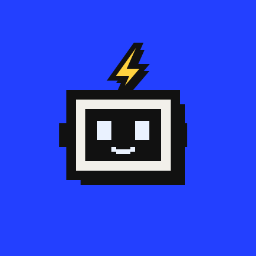

# HyperBot

**Tiny screen. Big mood.**

A palm-sized desk robot with a 128×64 pixel face. It yawns, winks, sulks and lights up when you poke it, and you run the whole thing from your Android phone over Bluetooth LE. No cloud, no account.

`ESP32-C3` · `0.96" SSD1306 OLED` · `Bluetooth LE` · `Android app` · `Browser installer`

App **v2.2.0** · Firmware **v2.1.1** · Website **[hyperbot-desk.netlify.app](https://hyperbot-desk.netlify.app)**

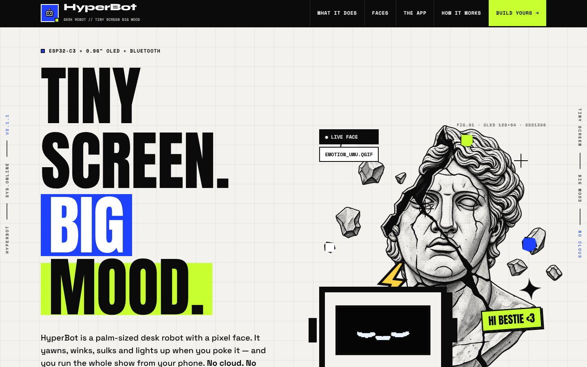

</div>

---

## Table of contents

1. [What it is](#what-it-is)
2. [Repository layout](#repository-layout)
3. [The faces](#the-faces)
4. [Hardware: parts and wiring](#hardware-parts-and-wiring)
5. [Firmware (ESP32-C3)](#firmware-esp32-c3)
6. [Android app](#android-app)
7. [Bluetooth protocol 3](#bluetooth-protocol-3)
8. [The .qgif animation format](#the-qgif-animation-format)
9. [Website and browser installer](#website-and-browser-installer)
10. [First boot and pairing](#first-boot-and-pairing)
11. [Building from source](#building-from-source)
12. [Troubleshooting](#troubleshooting)
13. [UI gallery](#ui-gallery)
14. [Credits and licence](#credits-and-licence)

---

## What it is

HyperBot is a full hardware + software project made of three parts that work together:

| Part | Folder | What it does |
|---|---|---|
| **Firmware** | [`firmware/`](firmware) | Runs on a Seeed XIAO ESP32-C3. Plays 1-bit animations on the OLED, receives new ones over BLE, handles pairing, pokes, buzzer melodies, a local web dashboard, Wi-Fi setup, MQTT / Home Assistant, weather, a timer and mini games. |
| **Android app** | [`app/`](app) | The remote. Connect, live-mirror the bot's screen, poke it, build playlists and mood presets, draw your own animations frame by frame, and convert any GIF or picture into an OLED animation. |
| **Website** | [`web/`](web) | Static Netlify site: a launch page, a step-by-step build guide, a one-click in-browser firmware installer (ESP Web Tools) and the APK download. |

Design language across the app and website: **brutalism** — heavy black borders, hard shadows, electric blue `#1F3BFF`, acid lime `#CCFF2E`, Anton / Syne / Space Grotesk / Space Mono type, and classical statue imagery cracked by pixel art.

---

## Repository layout

```text
HyperBot/
├── app/                        Android companion app (Android Studio / Gradle)
│   └── app/src/main/
│       ├── java/com/hyperbot/remote/   App source (Java)
│       ├── assets/animations/          Built-in .qgif library (23 animations)
│       ├── assets/fonts/               Anton, Syne, Space Grotesk, Space Mono (SIL OFL)
│       ├── assets/img/                 Statue artwork used in the UI
│       └── res/                        Launcher icon, HyperBot mark, styles
├── firmware/                   ESP32-C3 firmware (PlatformIO)
│   ├── src/                    Main app: BLE receiver, display state machine, pairing, pokes…
│   │   ├── games/              T-Rex Runner, Flappy Bird, Car Avoidance + menu
│   │   └── weather/            Open-Meteo weather screen + icons
│   ├── lib/gif_player/         .qgif player (LittleFS)
│   ├── lib/web_dashboard/      On-device web dashboard + REST API
│   ├── data/                   LittleFS image: dashboard HTML/CSS/JS + starter faces
│   ├── include/                Shared types, boot animations
│   ├── scripts/                Pre-build library patches
│   ├── flash_ready/            Prebuilt binaries (bootloader / partitions / firmware)
│   ├── partitions.csv
│   └── platformio.ini
├── web/                        Netlify website (no build step)
│   ├── index.html              Launch page
│   ├── build.html              Build guide + browser installer
│   ├── firmware/               Installer images + ESP Web Tools manifests
│   ├── downloads/              HyperBot APK
│   └── assets/                 CSS, JS, fonts, face GIFs, artwork
└── docs/screenshots/           UI screenshots used in this README
```

---

## The faces

Every animation is a real 128×64, 1-bit file that plays straight from the bot's flash. Each one loops for at least the configured dwell time (default 8 s, 2–60 s).

<table>
<tr>
<td align="center"><br><sub>uwu</sub></td>
<td align="center"><br><sub>yawn</sub></td>
<td align="center"><br><sub>wink</sub></td>
<td align="center"><br><sub>love</sub></td>
</tr>
<tr>
<td align="center"><br><sub>angry</sub></td>
<td align="center"><br><sub>sleepy</sub></td>
<td align="center"><br><sub>dizzy</sub></td>
<td align="center"><br><sub>devil</sub></td>
</tr>
<tr>
<td align="center"><br><sub>squint</sub></td>
<td align="center"><br><sub>ping pong</sub></td>
<td align="center"><br><sub>ugh</sub></td>
<td align="center"><br><sub>side-eye</sub></td>
</tr>
<tr>
<td align="center"><br><sub>sakura</sub></td>
<td align="center"><br><sub>rotate</sub></td>
<td align="center"><br><sub>bee</sub></td>
<td align="center"><br><sub>dragon</sub></td>
</tr>
</table>

The app ships 23 animations in `app/app/src/main/assets/animations/`. A fresh install from the website writes 5 starter faces to the bot (`firmware/data/*.qgif`).

---

## Hardware: parts and wiring

### Parts

| | Part | Notes |
|---|---|---|
| **C3** | Seeed XIAO ESP32-C3 | Brain: Bluetooth LE + Wi-Fi, USB-C. Other ESP32-C3 boards work if you match the pins. |
| **OL** | 0.96″ OLED, SSD1306, 128×64, I2C | The face. 4 pins: GND VCC SCL SDA. |
| **USB** | USB-C **data** cable | Charge-only cables are the #1 cause of "board not found". |
| **4×** | Jumper wires | Female-to-female, or solder short wires inside a case. |
| **PC** | Laptop with Chrome or Edge | For the one-click browser installer. |
| **APP** | Android phone | Android 8+ with Bluetooth LE. |
| **BZ** | Passive buzzer *(optional)* | Little beeps and melodies, on D0. |
| **BOX** | Case *(optional)* | 3D-print one, use a small box, or leave it naked. |

### Wiring

| Wire | OLED pin | XIAO pin | GPIO |
|---|---|---|---|
| Ground | GND | GND | — |
| Power | VCC | **3V3** | — |
| Clock | SCL | D9 | GPIO 9 |
| Data | SDA | D8 | GPIO 8 |
| Buzzer *(optional)* | + leg | D0 | GPIO 2 |

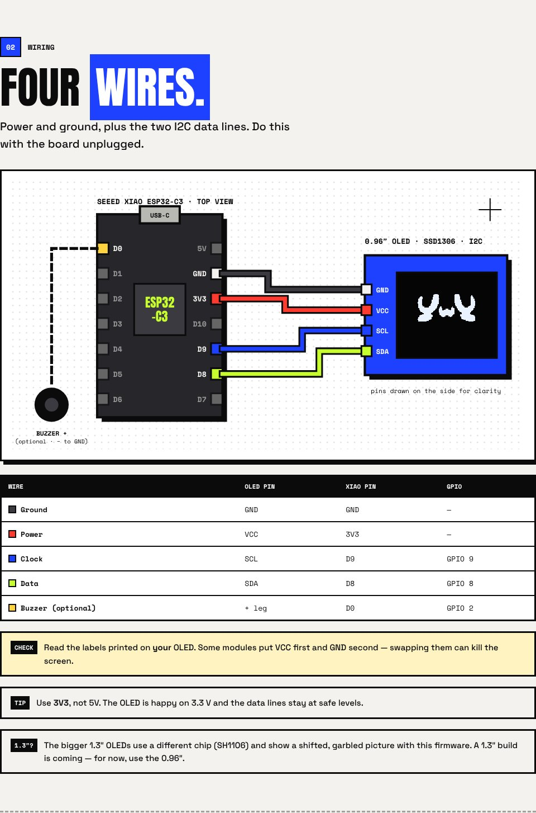

> **Check the labels on your OLED.** Some modules put VCC first and GND second; swapping them can kill the screen.
> Use **3V3, not 5V**.
> **1.3″ OLEDs** use the SH1106 chip and show a shifted picture with this firmware. Use the 0.96″ SSD1306 for now.

The firmware probes I2C addresses `0x3C` and `0x3D` at boot and prints a clear wiring hint on the serial console if no screen answers. Bluetooth keeps working, and the app shows "screen not detected".

---

## Firmware (ESP32-C3)

PlatformIO project, Arduino framework on the **pioarduino** platform (Arduino-ESP32 core 3.x), board `seeed_xiao_esp32c3`. Runs on FreeRTOS with separate tasks and queues for display, network and BLE.

### Features

- **Animation player** — plays `.qgif` files from LittleFS, shuffles the current playlist, adjustable speed, brightness and per-face dwell time.
- **BLE GIF receiver (protocol 3)** — receives single files or a whole playlist (1–8 animations) from the app with flow control and ACKs; keeps the files that already arrived if the link drops.
- **Live mirror** — publishes the name of the animation currently on screen so the app can show it in real time.
- **Pokes** — shows a sender name and a message, pre-rendered on the phone as bitmaps so emoji appear as pixels. Keeps a poke history.
- **Pairing and security** — 4-digit code on the OLED, random 16-hex token per phone, up to 4 phones remembered, tokens and codes never written to the serial log.
- **First-run setup** — hello screen, QR code to the app download page, then plays faces until a phone pairs.
- **Reset** — `RESET` from a paired phone, or power-cycle the bot 5 times in a row (each within 6 s of power-on). Forgets phones and setup; keeps GIFs and settings.
- **Buzzer melodies** — RTTTL tunes (NonBlockingRTTTL) with adjustable volume and mute.
- **Wi-Fi setup** — NetWizard captive portal (AP `HyperBot`), QR code on the OLED.
- **Local web dashboard** — served from LittleFS at the bot's IP: list, upload, delete and play `.qgif` files, storage info, speed / brightness / volume, timezone.
- **MQTT + Home Assistant** — auto-discovery; publishes poke events, mute state, current animation and connection state.
- **Extras carried over from QBIT** — weather screen (Open-Meteo, 1-hour cache), countdown timer with alarm, and three mini games (T-Rex Runner, Flappy Bird, Car Avoidance).

### Key source files

| File | Role |
|---|---|
| `src/main.cpp` | Boot: NVS, OLED probe, settings, RTOS queues, task start |
| `src/ble_gif_receiver.cpp` | BLE GATT service, protocol 3, file / playlist / poke transfer, PAIR / AUTH |
| `src/hb_setup.cpp` | First-run screens, pairing codes, token storage, reset logic |
| `src/display_task.cpp` | Display state machine (playback, pokes, menus, timer, games, Wi-Fi screens) |
| `src/network_task.cpp` | Wi-Fi, NetWizard portal, reconnect logic |
| `src/poke_handler.cpp` | Poke rendering, scrolling and history |
| `src/mqtt_ha.cpp` | Home Assistant discovery and state publishing |
| `src/settings.cpp` | NVS-backed settings: pins, brightness, volume, speed, dwell, MQTT |
| `lib/gif_player/` | `.qgif` decoder and player |
| `lib/web_dashboard/` | Dashboard routes and REST API |

### Web dashboard REST API

| Method | Path | Purpose |
|---|---|---|
| GET | `/api/list` | JSON list of `.qgif` files |
| GET | `/api/storage` | `{total, used, free}` |
| POST | `/api/upload` | Multipart `.qgif` upload |
| POST | `/api/delete?name=` | Delete a file |
| POST | `/api/play?name=` | Play a file now |
| GET / POST | `/api/settings` | Speed, brightness, volume (`?save=1` persists to NVS) |
| GET / POST | `/api/timezone` | Get / set IANA timezone |

### Flash layout

| Partition | Offset | Size |
|---|---|---|
| bootloader | `0x0` | — |
| partition table | `0x8000` | — |
| nvs | `0x9000` | 28 KB |
| app (firmware) | `0x10000` | 2.56 MB |
| LittleFS (faces + dashboard) | `0x2A0000` | 1.375 MB |

### Libraries

U8g2 2.36.18 · NetWizard 1.2.2 · ESPAsyncWebServer 3.12.1 · AsyncTCP 3.5.0 · ArduinoJson 7.4.3 · NonBlockingRTTTL 1.4.0 · ArduinoWebsockets 0.5.4 · PubSubClient 2.8 · QRCode 0.0.1 (all pinned in `platformio.ini`).

---

## Android app

Package `com.hyperbot.remote` · Java · minSdk 26 (Android 8.0) · targetSdk 35 · v2.2.0. Talks to the bot directly over BLE: no account, no cloud.

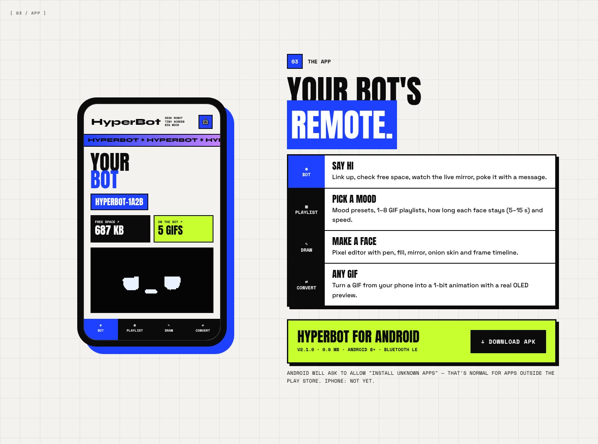

### Tabs

| Tab | What it does |
|---|---|
| **01 BOT** | Connect, see free space, **live mirror** of the face on the bot right now, **poke** it with a name and message (emoji rendered to pixels on the phone), and a step-by-step log. |
| **02 PLAYLIST** | **Mood presets** (Chill, Hyper, Sleepy, Love, Grumpy), a playlist of 1–8 animations, dwell time (5–15 s) and the filterable library. Sending replaces every animation on the bot and shuffles the new set. |
| **03 DRAW** | 128×64 pixel editor: pen, eraser, fill, brush size, mirror symmetry, onion skin, undo, nudge, up to 60 frames with per-frame timing and live playback. Start blank or remix a library animation. |
| **04 CONVERT** | Pick any GIF or picture. Fit / fill / stretch, dithering (none, pattern, smooth), brightness cut, invert, speed and frame count, all with a live OLED preview. |

Your own animations are stored privately in the app and appear under **PLAYLIST → LIBRARY → MINE** (long-press to delete).

### Source map (`app/app/src/main/java/com/hyperbot/remote/`)

| Class | Role |
|---|---|
| `MainActivity` | Hosts the pages and tab bar |
| `Splash`, `Hero`, `Deco`, `Brutal`, `Motion` | Splash screen, brutalist styling, decorations, animation helpers |
| `TabBar`, `Page`, `SendBar` | Navigation and shared page chrome |
| `BotPage` | BOT tab: connect, live mirror, poke, log |
| `PlaylistPage`, `Moods`, `Library` | Playlist, mood presets, animation library |
| `DrawPage`, `PixelCanvas` | Frame-by-frame pixel editor |
| `ConvertPage`, `GifDecoder`, `OledConverter` | GIF / image to 1-bit OLED conversion with dithering |
| `BotLink` | BLE client: scanning, pairing, AUTH, queued writes, flow control |
| `PokeRenderer` | Renders poke text and emoji to SSD1306 page-format bitmaps |
| `Qgif`, `QgifView` | `.qgif` parser and preview view |

### Requirements

- Firmware with BLE **protocol 3** (this repo, 2026-11-18 or later). Older firmware shows **WRONG FIRMWARE** on connect.
- Android 8.0+. On Android 11 and older, Location must be on for Bluetooth scanning.

---

## Bluetooth protocol 3

Service UUID `6c4f0001-8b5e-4a61-a3c2-7c7ab1d24000`

| Characteristic | UUID suffix | Use |
|---|---|---|
| CONTROL | `0002` | write: text commands |
| DATA | `0003` | write without response: file or bitmap bytes |
| STATUS | `0004` | read / notify: replies (value always holds the latest one) |
| NOW | `0005` | read / notify: file name of the animation on screen |

| Phone writes (CONTROL) | Bot replies (STATUS) |
|---|---|
| `HELLO` | `HELLO 3 <freeKB> <totalKB> <gifs> fw=<ver> auth=<0\|1> paired=<n> setup=<0\|1> oled=<0\|1>` |
| `PAIR` | `PAIR WAIT` (4-digit code appears on the OLED) |
| `PAIR <code>` | `PAIRED <token>` / `ERROR:PAIR_WRONG <triesLeft>` / `ERROR:PAIR_EXPIRED` / `ERROR:PAIR_LOCKED` |
| `AUTH <token>` | `AUTH OK` / `ERROR:AUTH_FAIL` |
| `FORGET` | `FORGOTTEN` (this phone is unpaired) |
| `RESET` | `RESETTING`, then reboot (forget all phones, setup again) |
| `PLAYLIST <count> <bytes>` | `WIPING`, then `PLAYLIST <freeKB>` |
| `BEGIN\n<name>\n<size>` | `READY <size>` |
| data on DATA | `ACK <bytes stored>` every 1.5 KB |
| `END` | playlist: `SAVED <n>`, then `PLAYING <n>` after the last; single file: `PLAYING` |
| `POKE <sw> <sl> <tw> <tl>\n<from>\n<text>` | `READY <sl+tl>`; send bitmaps on DATA; `END` → `POKED` |
| `ABORT` | `ABORTED` |

HELLO, AUTH, PAIR and ABORT work for anyone; everything else needs a paired phone (`ERROR:AUTH_REQUIRED` otherwise). The phone keeps at most 6 KB un-acknowledged (the bot buffers 8 KB), re-reads STATUS if a notification is lost, and checks free space before anything is deleted.

---

## The .qgif animation format

A small binary format for 128×64 monochrome animations, shared by the app, the firmware and the web dashboard.

```text
[0]        uint8   frame_count      (1..255)
[1..2]     uint16  width  = 128     (little-endian)
[3..4]     uint16  height = 64      (little-endian)
[5..]      uint16  delays[frame_count]   ms per frame (LE, min 20)
[..]       uint8   frames[frame_count][1024]   1 bit per pixel, bit 1 = pixel off
```

File size = `5 + 2·frames + 1024·frames` bytes.

---

## Website and browser installer

Static site in [`web/`](web), deployed on Netlify as **hyperbot-desk** → <https://hyperbot-desk.netlify.app> (the address the bot's first-boot QR code opens).

| Page | Content |
|---|---|
| `index.html` | Launch page: what HyperBot does, the faces, the app, how it works |
| `build.html` | 7-chapter build guide: parts, wiring, install, first boot, app + pair, play, help |

The installer uses **ESP Web Tools** (Web Serial), so it works in Chrome or Edge on desktop over https:

- **Fresh install** (`manifest-fresh.json`) — erases the board, writes firmware v2.1.1 and the LittleFS image with 5 starter faces; first-run setup starts.
- **Update firmware** (`manifest-update.json`) — replaces only the firmware; keeps GIFs, settings and paired phones.

**Deploy:** drag the `web/` folder onto the Netlify project's Deploys tab (or connect this repo with publish directory `web`). To update, replace the files in `web/firmware/`, bump `version` in both manifests, and replace the APK in `web/downloads/`.

<p>
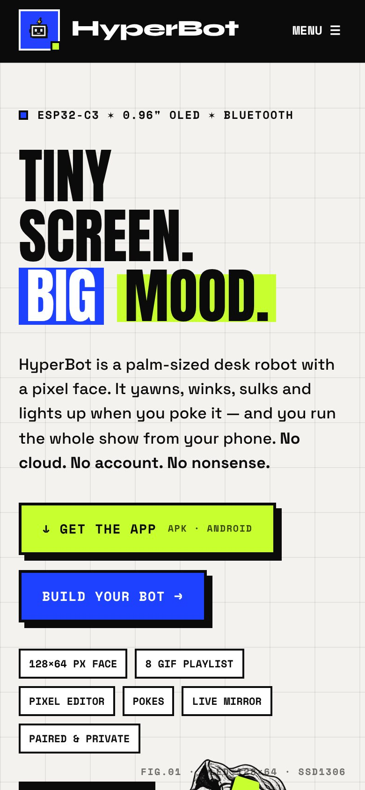
&nbsp;
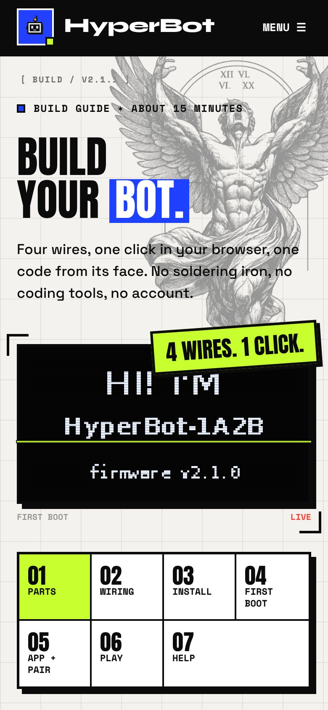
</p>

---

## First boot and pairing

| Time | Screen |
|---|---|
| 0–3 s | **Hello** — name (e.g. `HyperBot-1A2B`) and firmware version |
| 3–15 s | **Get my app** — QR code to the website's APK download |
| 15–45 s | **Just vibing** — plays faces so it never looks stuck, then loops |

<p>
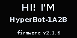

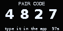
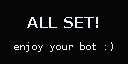
</p>

1. Install the APK and open it (allow "install unknown apps" for your browser).
2. Tap **Connect**, allow Bluetooth (and Location on Android 11 and older).
3. Type the 4-digit code shown on the bot. The code is valid for 2 minutes, 3 tries, then a new one is generated.
4. The bot shows **ALL SET!** and the app reconnects automatically next time.

Up to 4 phones can be paired; a 5th replaces the oldest. The setup screens never return after a power cycle, only after a reset.

---

## Building from source

### Firmware

```bash
cd firmware
pio run                      # build
pio run -t upload            # flash firmware
pio run -t uploadfs          # flash LittleFS (dashboard + starter faces)
pio device monitor -b 115200
```

Or flash the prebuilt images in `firmware/flash_ready/` with esptool:

```bash
esptool.py --chip esp32c3 write_flash 0x0 bootloader.bin 0x8000 partitions.bin 0x10000 firmware.bin
```

### Android app

Open `app/` in Android Studio → **Sync Project with Gradle Files** → **Run**, or:

```powershell
cd app
.\gradlew.bat assembleDebug
```

`app/local.properties` (your SDK path) is created by Android Studio and is not committed.

### Website

No build step. Serve `web/` with any static server, e.g. `npx serve web`, or deploy to Netlify.

---

## Troubleshooting

| Problem | Fix |
|---|---|
| Installer can't find the board | Use a data USB-C cable. Hold **BOOT** while plugging in. Close Arduino IDE / PlatformIO / serial monitors. |
| Screen stays black | Open *Logs & console* in the installer. `[OLED] NOT FOUND` → check VCC→3V3, GND→GND, SDA→D8, SCL→D9. |
| Picture shifted / garbled | You likely have a 1.3″ SH1106 OLED. Use a 0.96″ SSD1306. |
| App says "No HyperBot found" | Turn on Bluetooth (and Location on Android ≤ 11), keep the bot close. |
| App says **WRONG FIRMWARE** | Update the bot to firmware with BLE protocol 3. |
| Forgot / lost the paired phone | Power-cycle the bot 5 times in a row, each within 6 s of power-on. |

Logs: the BOT tab log in the app, `adb logcat -s HyperBot`, and `[BLE]` lines on the bot's serial port at 115200 baud.

---

## UI gallery

### Website — launch page

| | |
|---|---|
| 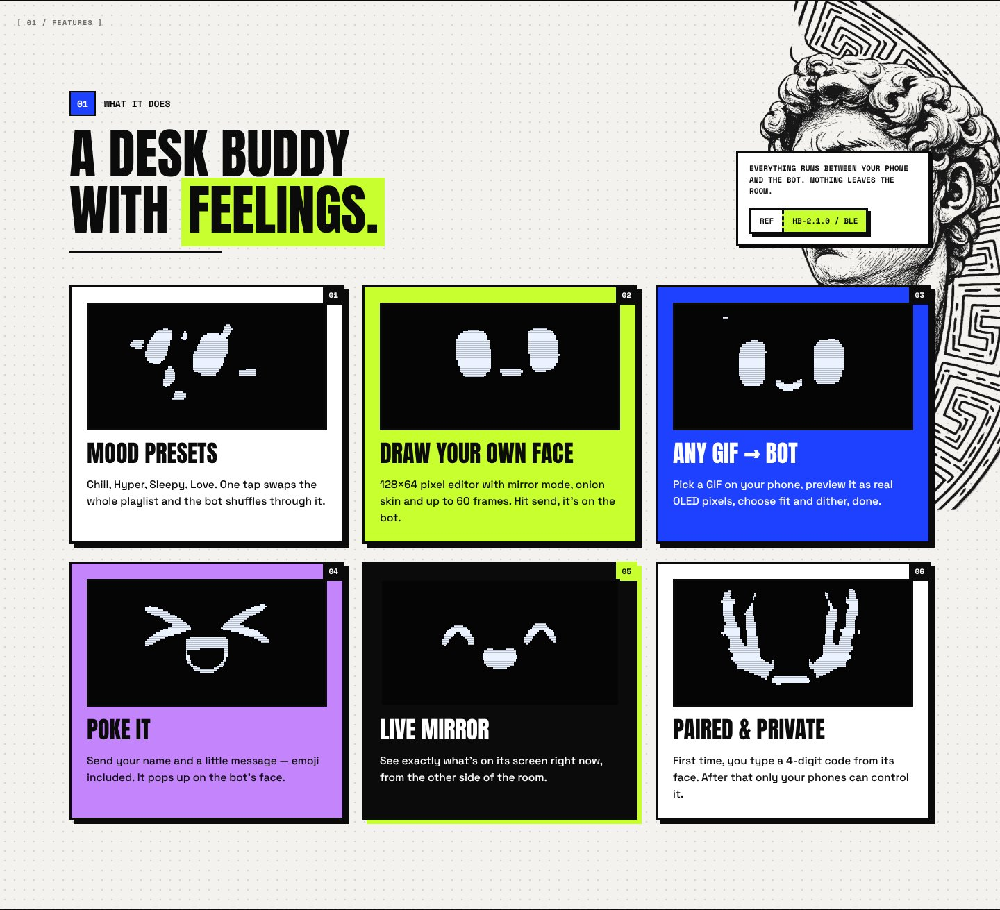 | 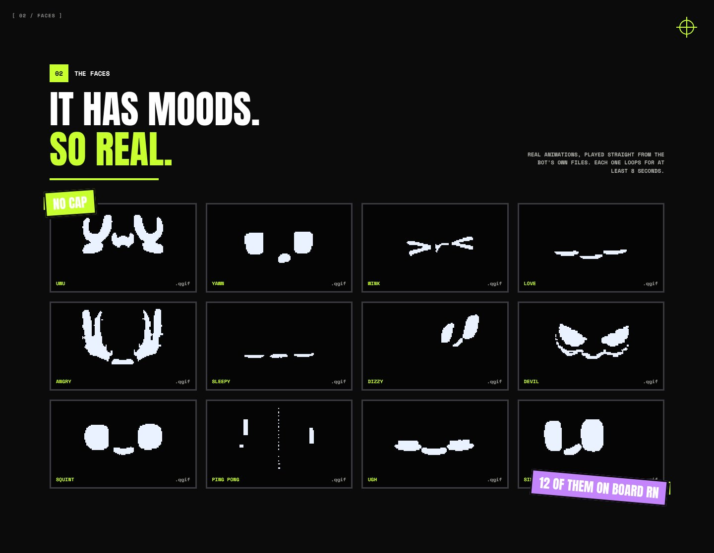 |
|  | 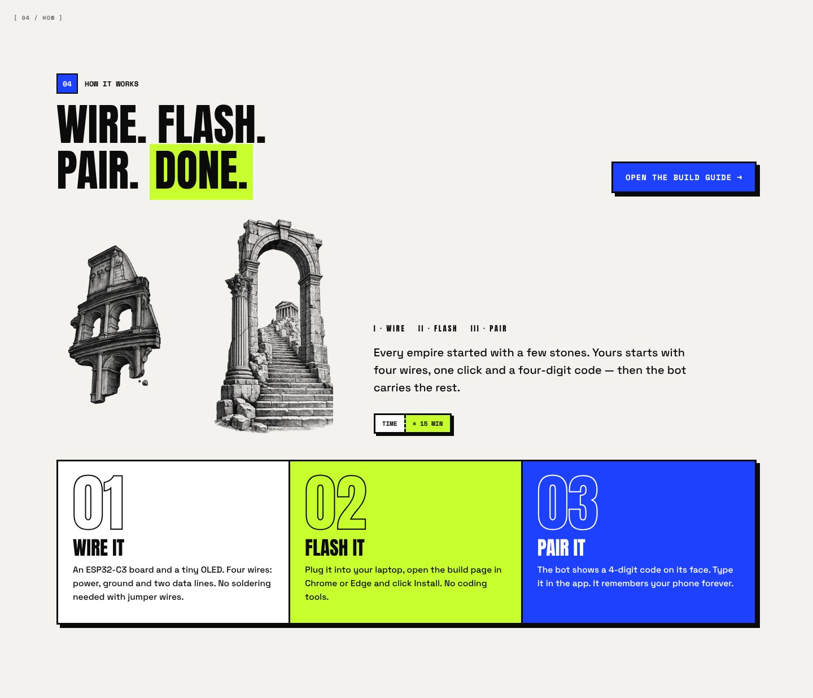 |

### Website — build guide

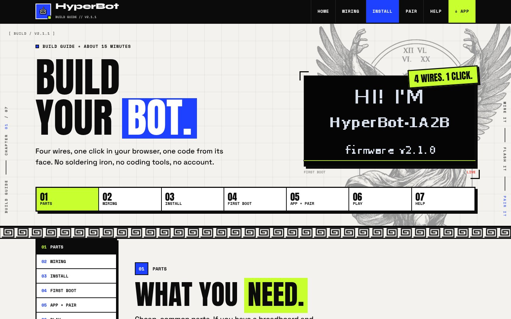

| | |
|---|---|
| 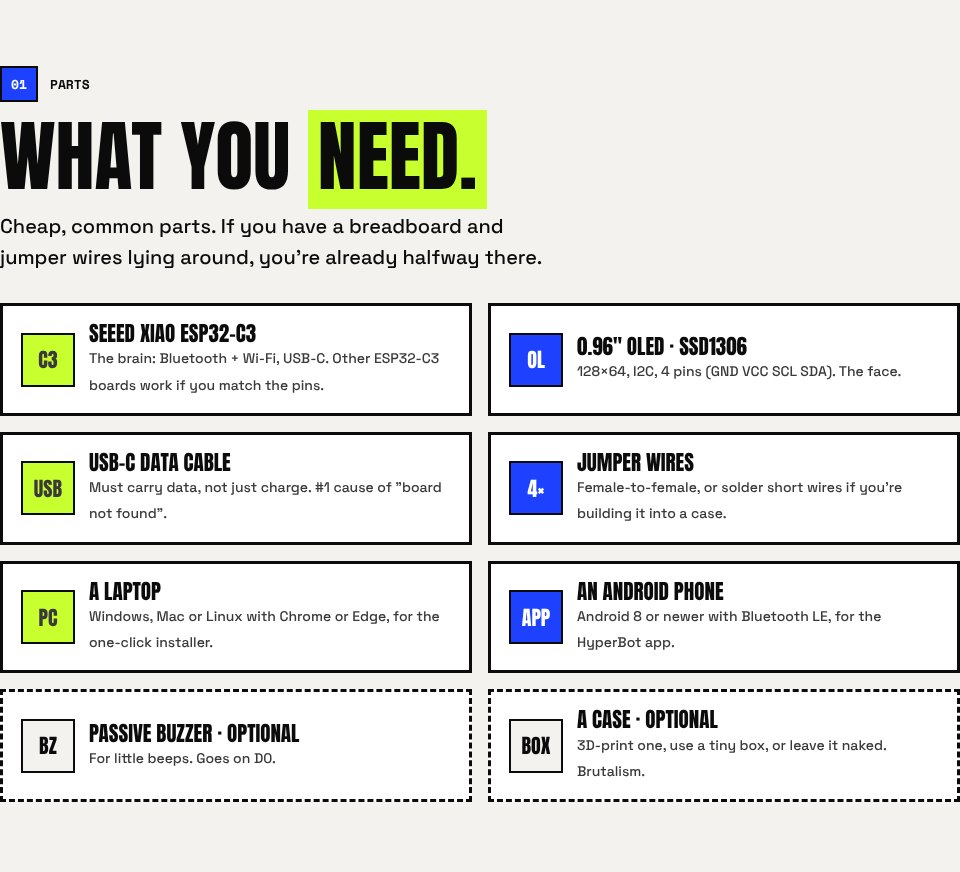 |  |
| 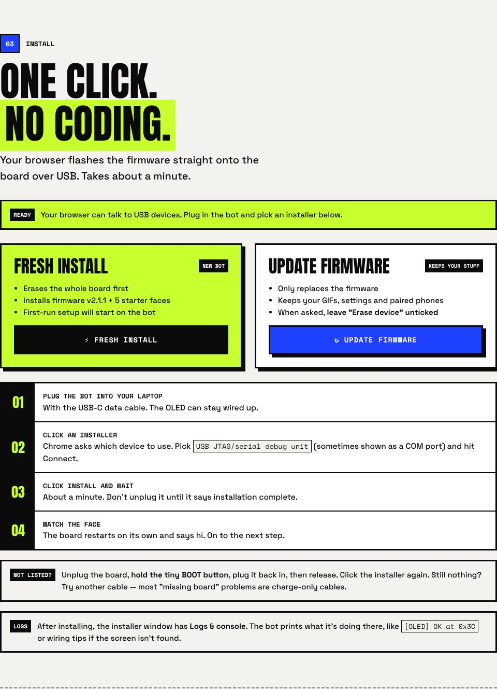 | 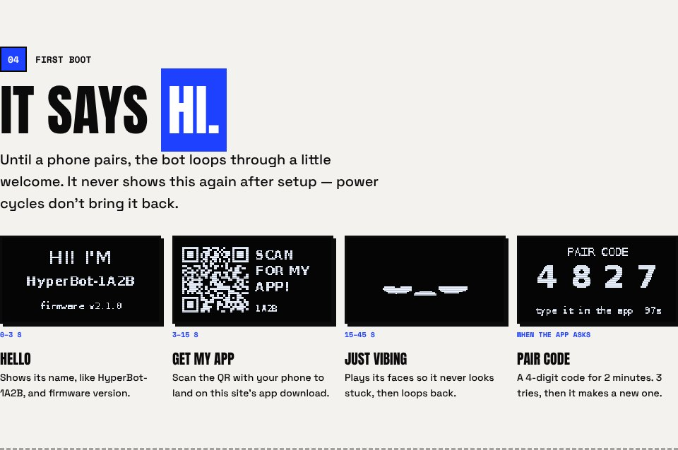 |
| 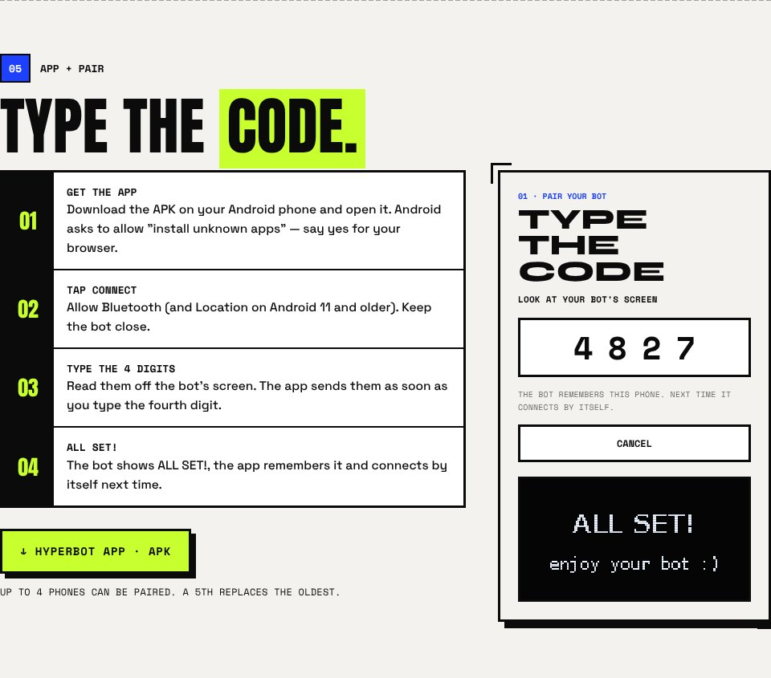 | 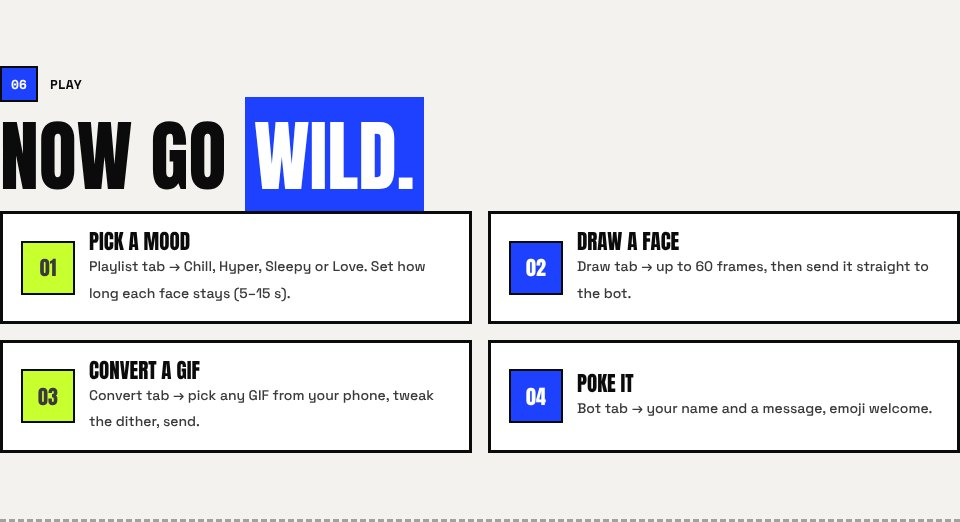 |

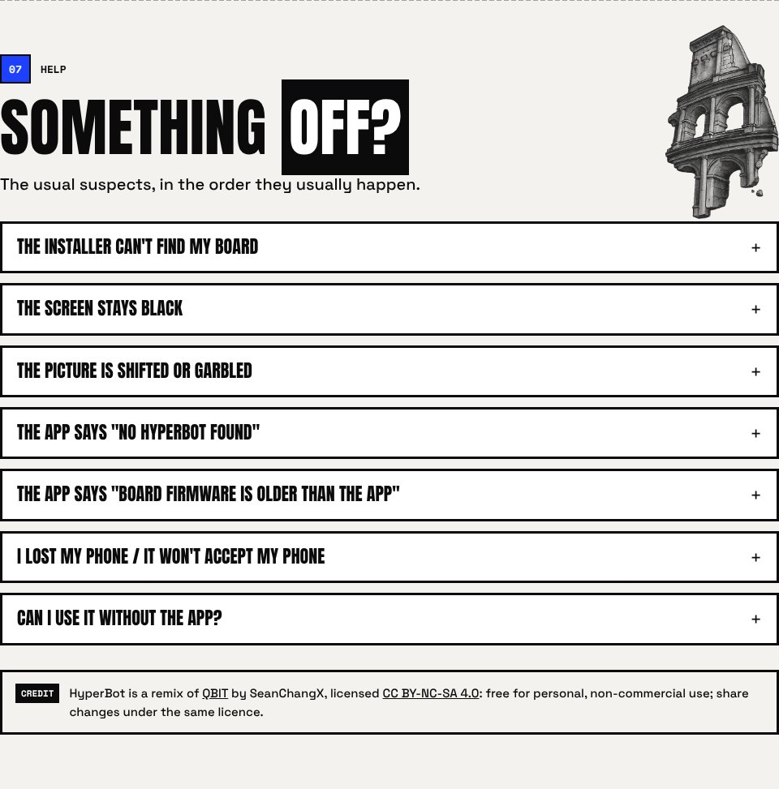

### Social preview

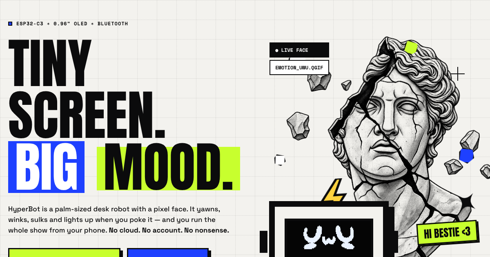

---

## Credits and licence

HyperBot is a remix of **[QBIT by SeanChangX](https://github.com/SeanChangX/QBIT)**, which it uses as inspiration and reference. QBIT is licensed under **[CC BY-NC-SA 4.0](https://creativecommons.org/licenses/by-nc-sa/4.0/)**, so HyperBot is shared under the same licence: **non-commercial use only, credit the original, and share changes under the same licence.**

Fonts (Anton, Syne, Space Grotesk, Space Mono) are under the SIL Open Font License; licence files are in `app/app/src/main/assets/fonts/` and `web/assets/fonts/`.

Built by **Ashish** · Alphaion
